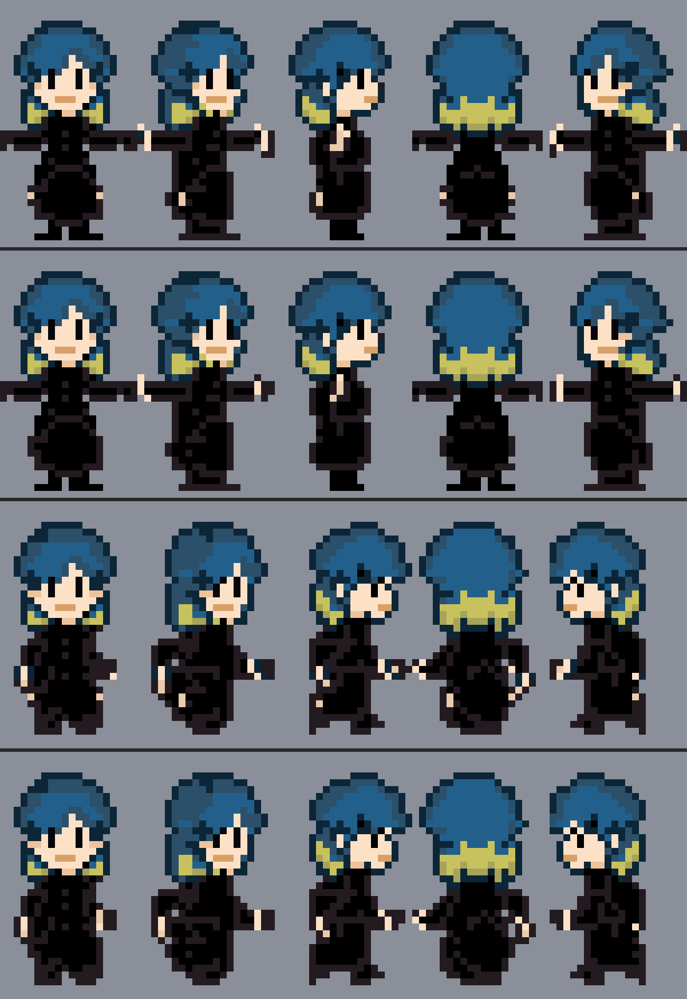
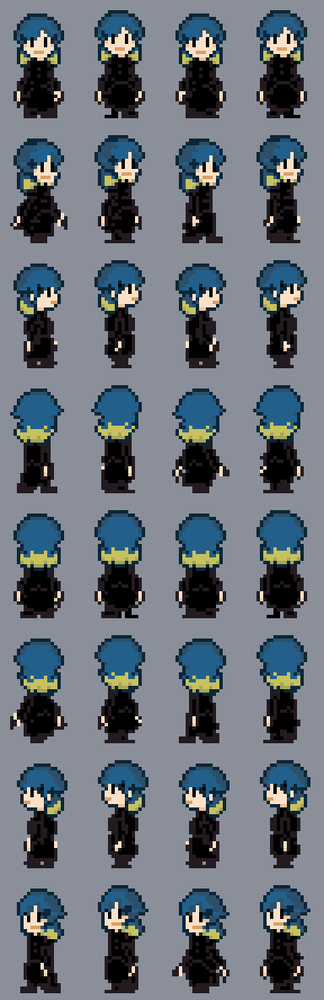

# dot-go

ドット絵 (1 体 15〜30 × 30〜40 画素ほど、2 頭身くらい) を立体にして、向きを変える・ポーズをとらせる・アニメにする道具の集まり。
どれも Godot 4.6 で動きます。



## 中身

| フォルダ | アプリ | すること |
| --- | --- | --- |
| [dot-solid](dot-solid/) | dot-Godough 立体 | 正面のドット絵 (と、あれば横・後ろの絵) から立体を作り、ほかの向きの絵を出す。向きごとに描き直せる。ドット絵モデル (`.dotmodel.json`) に保存 |
| [dot-godough-motion](dot-godough-motion/) | dot-Godough モーション | ドット絵モデルに動きをつけて、Aseprite・GIF・スプライトシートに書き出す。ぐるっと一周の書き出しも |
| [dot-godough](dot-godough/) | dot-Godough | SDF で作った人体をその場でドット絵にして、体型・服・髪・ポーズを決めるキャラメーカー。立体化の機能 (「立体」タブ) の元もここ |

ふつうの流れ:

1. **dot-solid** で ドット絵を開く → 1 体を選んで「正面にして 立体を作る」→ 横・後ろの絵があれば足す → 向きを変えながら描き直す → 保存
2. **dot-godough-motion** で そのモデルを開く → コマにポーズをつける → Aseprite / GIF / シートに書き出す

8 方向の歩きスプライト (シート PNG・Aseprite・GIF) だけなら、dot-solid の右の「歩き (8 方向)」からすぐ出せます。



## 動かすもの

- [Godot 4.6](https://godotengine.org/) (dot-godough は C# を使うので **.NET 版** と .NET SDK。ほかの 2 つは GDScript だけなので どちらの版でも動く)
- 各フォルダの `Run.bat` は `%USERPROFILE%\Godot_v4.6-stable_mono_win64\` にある Godot を起こします。別の場所に置いたときは `Run.bat` の 1 行を書きかえるか、Godot で各フォルダの `project.godot` を開いてください
- Windows で作って確かめています

## 立体の作り方 (かんたんに)

- 正面の絵の行ごとに、部品 (頭・胸・腰・腕・ひじから先・脚・ひざから下) ごとの だ円を立てて重ねる。奥行きは横の絵の幅、無ければ横幅 × 比率
- 色は 部品ごとに いちばん近い向きの絵 1 枚から取る。顔 (肌・目・口) は 頭の面から切りはなした別の層で、横を向くと すべって縮む
- 輪郭線は 描いた絵の線の色を覚えておいて、向きを変えた絵のふちに 引き直す
- 描いた画素は 立体に置かれ、描いた向きの近く (± 20°) でだけ出る。描きかえた向きには ほかの向きで描いたものは出ない
- 腕は丸い管。手は いつも腕の立体が描く (体の絵に描いてある手は消す)

くわしくは [dot-godough/docs/SOLID.md](dot-godough/docs/SOLID.md) と、図つきの [dot-godough/docs/solid-explainer.html](dot-godough/docs/solid-explainer.html)。

## 同じファイルが 3 か所に

立体を描く `scripts/solid.gd` (と `pixel_view.gd`・`xp.gd`) は 3 つのアプリで同じものです。元は `dot-godough/scripts/`。
直したら `dot-solid/Sync.bat`・`dot-godough-motion/Sync.bat` で写してください (3 つのフォルダが このリポジトリと同じ並びにあることが前提)。

## 確かめ

各フォルダで (画面が開いて、数字と絵を出して閉じる):

```
Godot --path . -- --selftest <出力のフォルダ>
```

手が体に残らないか・増えないかを ポーズ × 向き で数える:

```
cd dot-godough
Godot --headless --path . -s tools/hand_check.gd -- check 15 <モデル (.dotg.json / .dotmodel.json)>
```

## 向きの名前

90° は「顔が画面の右を向いた絵」ですが、向きの名前では「左」です (キャラから見た左)。ボタンには見た目のほうを書いてあります。
