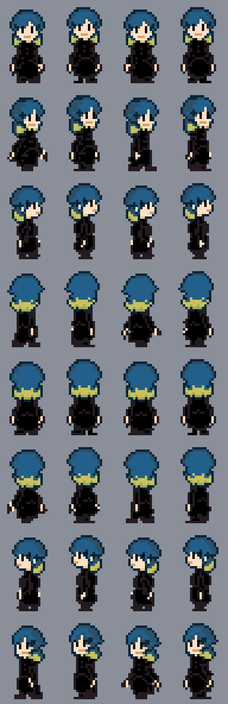

# dot-Godough 立体

ドット絵 (正面の絵 1 枚〜) から立体を作り、向きを変えた絵を直すアプリ (Godot 4.6、GDScript だけ)。
dot-godough の「立体」タブにあった機能を、これだけで動くように分けたもの (2026-11-15)。体型・服・髪を作る 3D のキャラクリエイトは入っていない。

- 起動: `Run.bat`
- 確かめ: `Run.bat -- --selftest <出力のフォルダ>` (tests/selftest.gd)

## 流れ

1. 「絵を開く」で PNG を開く (1 体だけの絵でも、何体も並んだ表でも。左上の色が背景なら透明として扱う)
2. 「絵から作る」タブ: 絵の上の 1 体をクリックして選ぶ (となりと くっつくときは 引いて囲む) →「正面にして 立体を作る」
3. 横・後ろの絵があれば、同じように選んで「横…」「後ろ姿」(無ければ推定)
4. 「描く」タブで 向きを変えながら直す。「部品」で 部品の分け方を直す。「ポーズ」で 動かして確かめる。「設定」で 奥行き・肩・腰など
5. 「保存」(`.dotmodel.json`) →「モーションで開く」で 動きをつける (となりのフォルダ dot-godough-motion)

## 描く

| | |
|---|---|
| えんぴつ B・消しゴム E・バケツ G・線 L・四角 U / Shift+U・スポイト I | 右ボタンは どの道具でも消す。Alt + クリックで色を拾う |
| ← → | 向きを 45° ずつ |
| Ctrl+Z / Ctrl+Y / Ctrl+S | 元に戻す / やり直す / 保存 |

- ふつうは 描いた画素を 立体に置く (立体の上でも空中でも同じ。消す = けずる)。もとの絵は変わらない。描いた向きと その近く (± 20°) で出る
- 描きかえた向きには、ほかの向きで描いたものは出ない
- 「その向きの絵を決める」を入れると、45° ごとの絵そのものを直す (立体を作り直す)
- 描けるのは「描く」タブだけ (部品・ポーズ・設定のタブで 絵をクリックしても 画素は置かれない)

## 手

手は いつも 腕の立体が描く (体の絵に描いてある手は使わない)。手の色 = 顔の肌の色と、手にだけ使われている 少し濃い かげの色。
腕を動かしても 手の色が体に残るときは、「部品」タブで その画素を腕に塗るか、「設定」の「肌とみなす色の広さ」を上げる。

## 8 方向の歩きスプライト

右の「歩き (8 方向)」から、立体の歩き 4 コマ (右足 → 両足 → 左足 → 両足、6 コマ/秒) を 8 方向で書き出す。モデルを保存しなくても出せる。

- **シート PNG**: 行 = 向き (上から 正面・左ななめ前・左・左ななめ後ろ・後ろ・右ななめ後ろ・右・右ななめ前)、列 = コマ。1 コマ = 紙の大きさ。となりに `.json` (コマの大きさ・コマ数・速さ・行の向き)
- **Aseprite**: 32 コマ。向きごとにタグ (「歩き 正面」…)
- **GIF**: 8 方向を 4 × 2 に並べて 2 倍で動かす

歩き方を変えたいときは、モデルを保存して「モーションで開く」で「歩き」のアニメを直し、そちらの「歩き (8 方向)」で書き出す。

## 向きの名前

90° は「顔が画面の右を向いた絵」だが、向きの名前は「左」(dot-godough・モーションと同じ並び)。ボタンには 見た目のほうを書いてある。

## dot-godough と同じファイル

`scripts/solid.gd`・`pixel_view.gd`・`xp.gd` は dot-godough の写し。向こうを直したら `Sync.bat` (モーション側も同じ)。仕組みは dot-godough の `docs/SOLID.md`。

## まだ無いもの

- 3D で見るタブ、右の小さい絵に じかに描くこと、ドット直し (その向きだけの上書き)
- 選んで動かす・色の置きかえ などの道具
